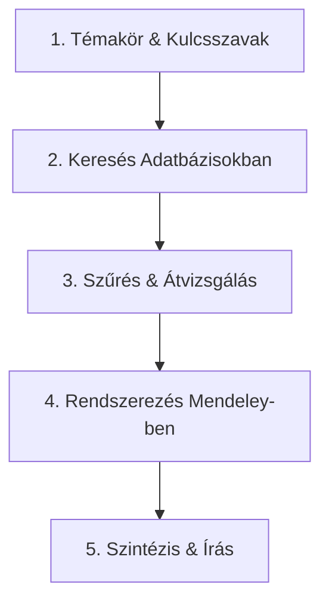

# Hagyományos Irodalomkutatás Cheat Sheet

> **Cél:** Gyors, hatékony és rendszerezett útmutató diplomatervezőknek az elméleti háttér összefoglalásához.

Az irodalomkutatás feladata biztosítani, hogy a végzett kutatás és az elkészült dolgozat állításai tudományosan megalapozottak legyenek. Ebből a célból áttekintjük a tudomány jelenlegi állását a közzétett publikációk tanulmányozása révén és azokat a cikkeket, közleményeket behivatkozzuk a saját dolgozatunkban, melyeket relevánsnak találunk.

---

## A jó irodalomkutatás 3 alapszabálya

1. **Nem mesekönyv:** Ne csak összefoglalja, vagy felsorolja a cikkeket egymás után, hanem **hasonlítsa össze** őket!
2. **Frissesség és alapok:** Használjon klasszikus alapműveket (fogalmakhoz), de a források többsége legyen **az elmúlt 5-10 évből**.
3. **Nem Wikipédia:** Csak lektorált (*peer-reviewed*) cikkeket, könyveket, konferenciakiadványokat használjon.

---

## 5 Lépéses munkamenet

### 1. Kulcsszavak és a téma lehatárolása

- Fogalmazza meg a fő kérdésedet!
- Gyűjtsön **angol kulcsszavakat** (a releváns szakirodalom 90%-a angolul van).
- Használjon **Boolean (halmaz) operátorokat**:
  - `AND` (szűkít): `computer vision AND autonomous vehicles`
  - `OR` (bővít): `deep learning OR neural networks`
  - `""` (ponton kifejezés): `"object detection"`

### 2. Hol keressen? (Megbízható adatbázisok)

- **Általános / Kezdéshez:** [Google Scholar](https://scholar.google.com) vagy [Mendeley]([Search | Mendeley](https://www.mendeley.com/search/)) (állítsa be az egyetemi könyvtári hozzáférést!)
- **Műszaki / Informatikai:** IEEE Xplore, ACM Digital Library, ScienceDirect, Scopus, ResearchGate
- **Tipp:** Ha egy jó cikket talál, nézze meg a **hivatkozásait** (visszafele keresés) és azt is, hogy **kik hivatkozták le** 

### 3. Gyors szűrés (Hogyan olvashat hatékonyan?)

Ne olvassa el a teljes cikket azonnal!
1. **Cím + Absztrakt:** Megválaszolja a kérdését? Ha nem -> Kuka.
2. **Ábrák / Táblázatok:** Gyorsan áttekinthetők.
3. **Bevezetés & Következtetés (Conclusion):** Milyen eredményre jutottak, kell ez nekem a dolgozatba?
4. **Teljes cikk:** Csak akkor olvassa végig, ha valóban kulcsfontosságú a dolgozat és a kutatás szempontjából!

---

## Referenciakezelés: Mendeley (és Zotero)

### Mendeley használata (Preferált)

1. **Mendeley Web Importer:** Telepítse a böngészőbe! 1 kattintással elmentheti a cikket és a PDF-et.
2. **Mendeley Reference Manager:** 
   - Hozzon létre **mappákat** a diplomaterv fejezetei szerint (pl. `01_Bevezetes`, `02_Módszertan`).
   - Állítson be **Citation Key**-t : pl. `Kim2024`.
   - A Citation Key használható LaTeX környezetben hivatkozás beszúrására: '\cite{Kim2024}' 
1. **Mendeley Cite (MS Word plugin):** 
   - Beszúrás egy kattintással Word-ben.
   - Automatikus Irodalomjegyzék generálás a kiválasztott stílusban (pl. *IEEE* vagy *APA 7th*).

> **Megjegyzés (Zotero):** Ha a jövőben nyílt forráskódú, rendkívül testreszabható eszközre váltana, a Zotero is kiváló alternatíva.

---

## Példa: Hogyan írja meg a szöveget?

### Rossz példa (Katalógus-szerű felsorolás):

> Nagy (2020) szerint a mélytanulási modellek hatékonyak az képfeldolgozásban. Kovács (2022) azt mondta, hogy a YOLOv8 algoritmus gyors. Smith (2023) pedig a CNN hálózatokat vizsgálta.

### Jó példa (Szintézis és összehasonlítás):

> Az objektumdetektálási feladatok során a mélytanulási modellek váltak meghatározóvá (Nagy, 2020). Míg a hagyományos CNN alapú architektúrák magas pontosságot érnek el, számítási igényük miatt valós idejű alkalmazásuk korlátozott (Smith, 2023). Ezzel szemben Kovács (2022) kimutatta, hogy a YOLOv8 algoritmus jelentős sebességnövekedést biztosít minimális pontosságvesztés mellett, ami különösen előnyös beágyazott rendszerek esetén.

Amennyiben a formátum megköveteli, a hivatkozás történhet számmal is: 

> Az objektumdetektálási feladatok során a mélytanulási modellek váltak meghatározóvá [1].

---

##  Gyors Csekklista a Diplomatervhez

- [ ] Megvan a 15–25 releváns, döntően angol nyelvű szakirodalom?
- [ ] Be vannak importálva a források Mendeley-be (PDF-fel együtt)?
- [ ] Minden állítást, ami nem a saját gondolat/eredmény, alátámasztott hivatkozással?
- [ ] Egységes a hivatkozási stílus az egész dokumentumban?

