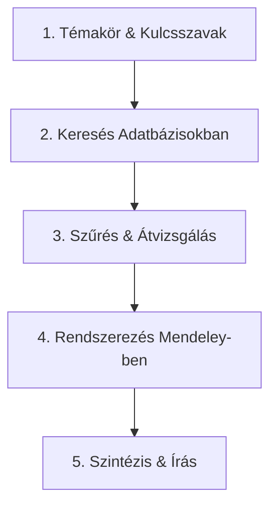

# Hagyományos Irodalomkutatás Cheat Sheet

> **Cél:** Gyors, hatékony és rendszerezett útmutató diplomatervezőknek az elméleti háttér összefoglalásához.

Az irodalomkutatás feladata biztosítani, hogy a végzett kutatás és az elkészült dolgozat állításai tudományosan megalapozottak legyenek. Ebből a célból áttekintjük a tudomány jelenlegi állását a közzétett publikációk tanulmányozása révén és azokat a cikkeket, közleményeket behivatkozzuk a saját dolgozatunkban, melyeket relevánsnak találunk.

---

## A jó irodalomkutatás aranyszabályai

1. **Nem mesekönyv (Kritikus szemlélet):** Ne csak leírja vagy egymás után felsorolja a cikkeket, hanem **hasonlítsa össze és vesse össze őket!** Egyetlen forrás állításait ne fogadja el vakon — keressen több, egymástól független forrást a megállapítások igazolására.
2. **Frissesség és alapok:** Használjon klasszikus alapműveket a fogalmak tisztázására, de a források többsége legyen **az elmúlt 5–10 évből**.
3. **Források és a Wikipédia használata:**
   * **Elfogadható források:** Lektorált (*peer-reviewed*) tudományos cikkek, könyvek, konferenciakiadványok mellett **hivatalos weboldalak, szakmai weblapok és publikus forráskódok (pl. GitHub repók)** is hivatkozhatóak, ha azok a témához relevánsak és megbízhatóak.
   * **Mi a helyzet a Wikipédiával?** A Wikipédia jó kiindulópont a témával való ismerkedéshez, de közvetlenül hivatkozni ritkán szerencsés. Ha a Wikipédiát használja, **nézze meg a szócikk alján található eredeti forrásokat**, keresse vissza azokat, és a tényleges tudományos/hivatalos forrásra hivatkozzon!

---

## 5 Lépéses munkamenet

### 1. Kulcsszavak és a téma lehatárolása

Fogalmazza meg a fő kérdést (Research Question) vagy a hipotézist! De ne csak egyetlen kifejezésre keressen rá! 
A témakör mellett érdemes több szempont alapján felépíteni a keresést:

* **Témakör és kulcsszavak:** 
  * Gyűjtsön szinonímákat (pl. *machine learning*, *automated decision-making*).
  * Használjon halmazműveleteket: `AND`, `OR`, `NOT` (pl. `"neural networks" AND "medical imaging"`).
* **Kulcsszerzők (*Key authors*):** 
  * Ha talál 1-2 nagyon jó cikket, nézze meg, kik a szerzői! A szakterület meghatározó kutatói gyakran több kulcsfontosságú cikkben is társszerzők.
* **Neves folyóiratok és konferenciák:** 
  * Az adott szakterület vezető folyóiratai (pl. *IEEE*, *Elsevier / Springer szakkfolyóiratok*) garantálják a magas szakmai minőséget.
* **Archívumok és preprint szerverek:** 
  * A legfrissebb, még megjelenés alatt álló kutatásokhoz használjon nyílt archívumokat (pl. **arXiv**, **ResearchGate**, **IEEE Xplore**, **ACM Digital Library**).
* **Megbízható kiadók:** 
  * Preferálja az elismert tudományos kiadókat (pl. *Springer*, *Elsevier*, *IEEE*, *Wiley*).
* **Miskolci Egyetemi szerzők:**
  * Ne feledje, hogy a **Miskolci Egyetem oktatói és kutatói** is számos szakterületen publikálnak nemzetközileg elismert cikkeket. Érdemes rákeresni a saját oktatói, konzulensei publikációira is: ezzel nemcsak releváns, közvetlenül elérhető hazai forrásokhoz juthat, de segíti az egyetem és a konzulensek tudományos elismertségét is. Ráadásul ha kérdése merül fel egy cikkel kapcsolatban, a szerzők közvetlenül a campuson elérhetőek!
* **Kezdje áttekintő (*Review / Survey*) cikkekkel!**
  * Ha egy széles témakörben könnyen elveszne a több száz szakcikk között, keressen rá a **"review"** vagy **"survey"** kulcsszavakra (pl. *"machine learning in healthcare survey"*). 
  A *review* cikkek célja pontosan az, hogy összefoglalják és strukturálják egy teljes kutatási terület főbb irányait, eredményeit és nyitott kérdéseit. Néhány ilyen cikk átnézésével sokkal gyorsabban kap átfogó képet a témáról, és könnyebben lehatárolhatja a saját szakdolgozati/diplomaterv témáját is!

### 2. Hol keressen? (Megbízható adatbázisok)

- **Általános / Kezdéshez:** [Google Scholar](https://scholar.google.com) vagy [Mendeley]([Search | Mendeley](https://www.mendeley.com/search/)) (állítsa be az egyetemi könyvtári hozzáférést!)
- **Műszaki / Informatikai:** IEEE Xplore, ACM Digital Library, ScienceDirect, Scopus, ResearchGate
- **Tipp:** Ha egy jó cikket talál, nézze meg a **hivatkozásait** (visszafele keresés) és azt is, hogy **kik hivatkozták le** 

### 3. Gyors szűrés (Hogyan olvashat hatékonyan?)

Ne olvassa el a teljes cikket azonnal!
1. **Cím + Absztrakt:** Megválaszolja a kérdését? Releváns a hipotézis tekintetében? Ha nem -> Kuka.
2. **Ábrák / Táblázatok:** Gyorsan áttekinthetők.
3. **Bevezetés & Következtetés (Conclusion):** Milyen eredményre jutottak, kell ez nekem a dolgozatba?
4. **Teljes cikk:** Csak akkor olvassa végig, ha valóban kulcsfontosságú a dolgozat és a kutatás szempontjából!

---

## Referenciakezelés: Mendeley (és Zotero)

### Mendeley használata (Preferált)

1. **Mendeley Web Importer:** Telepítse a böngészőbe! 1 kattintással elmentheti a cikket és a PDF-et.
2. **Mendeley Reference Manager:** 
   - Hozzon létre **mappákat** a diplomaterv fejezetei szerint (pl. `01_Bevezetes`, `02_Módszertan`).
   - Állítson be **Citation Key**-t : pl. `Kim2024`.
   - A Citation Key használható LaTeX környezetben hivatkozás beszúrására: '\cite{Kim2024}' 
1. **Mendeley Cite (MS Word plugin):** 
   - Beszúrás egy kattintással Word-ben.
   - Automatikus Irodalomjegyzék generálás a kiválasztott stílusban (pl. *IEEE* vagy *APA 7th*).

> **Megjegyzés (Zotero):** Ha a jövőben nyílt forráskódú, rendkívül testreszabható eszközre váltana, a Zotero is kiváló alternatíva.

---

## Példa: Hogyan írja meg a szöveget?

### Rossz példa (Katalógus-szerű felsorolás):

> Nagy (2020) szerint a mélytanulási modellek hatékonyak az képfeldolgozásban. Kovács (2022) azt mondta, hogy a YOLOv8 algoritmus gyors. Smith (2023) pedig a CNN hálózatokat vizsgálta.

### Jó példa (Szintézis és összehasonlítás):

> Az objektumdetektálási feladatok során a mélytanulási modellek váltak meghatározóvá (Nagy, 2020). Míg a hagyományos CNN alapú architektúrák magas pontosságot érnek el, számítási igényük miatt valós idejű alkalmazásuk korlátozott (Smith, 2023). Ezzel szemben Kovács (2022) kimutatta, hogy a YOLOv8 algoritmus jelentős sebességnövekedést biztosít minimális pontosságvesztés mellett, ami különösen előnyös beágyazott rendszerek esetén.

Amennyiben a formátum megköveteli, a hivatkozás történhet számmal is: 

> Az objektumdetektálási feladatok során a mélytanulási modellek váltak meghatározóvá [1].

---

##  Gyors Csekklista a Diplomatervhez

- [ ] Megvan a 15–25 releváns, döntően angol nyelvű szakirodalom?
- [ ] Be vannak importálva a források Mendeley-be (PDF-fel együtt)?
- [ ] Minden állítást, ami nem a saját gondolat/eredmény, alátámasztott hivatkozással?
- [ ] Egységes a hivatkozási stílus az egész dokumentumban?

